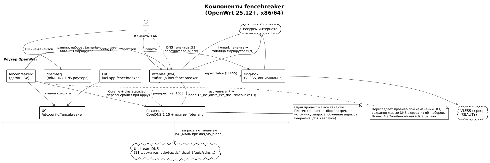

# fencebreaker

**Многотенантная политика маршрутизации для OpenWrt.**

Несколько независимых «тенантов» на одном роутере: каждый направляет трафик
выбранных сетей и хостов на выбранные ресурсы через собственный канал —
обычный интерфейс (второй WAN, VPN-интерфейс) либо VLESS (sing-box,
TCP/TLS/REALITY) — с раздельными списками проксируемых адресов, собственной
DNS-логикой и правилами отказа канала.

Примеры: гостевая сеть через резервного провайдера; рабочие машины через
корпоративный VLESS, а банки — напрямую; «всё через туннель, кроме
доверенных ресурсов». Всё настраивается в LuCI или UCI, без ручного
редактирования nftables.

| | |
|---|---|
| Платформа | OpenWrt 25.12+ (apk), x86/64 |
| Интерфейс | LuCI (русский) + UCI |
| DNS | CoreDNS 1.15 с плагином `fbtenant` |
| Маршрутизация | nftables (fw4), fwmark + таблицы маршрутов |
| VLESS | sing-box (опционально) |



## Установка

Требуется OpenWrt 25.12+ (apk) на x86/64 и ~60 МБ свободного места
(занимает основной объём CoreDNS). sing-box нужен только для VLESS.

### Автоустановка (GitHub Releases)

```sh
# на роутере: пакеты последнего релиза
curl -sfL https://raw.githubusercontent.com/leidruid/fencebreaker/main/scripts/install-openwrt.sh | sh -

# с sing-box для VLESS-каналов:
curl -sfL https://raw.githubusercontent.com/leidruid/fencebreaker/main/scripts/install-openwrt.sh | sh -s -- --with-singbox
```

Другие режимы и опции: `--version v0.1.0` (конкретный релиз), `--repo URL`
(apk-репозиторий), `--dir DIR` (локальные .apk), `--no-i18n`.

Скрипт проверяет окружение (root, OpenWrt, архитектуру, место), скачивает
`.apk` из релиза, ставит пакеты `fencebreaker` + `fencebreaker-coredns` +
`luci-app-fencebreaker` (+ русская локализация), включает и запускает
сервис. Повторный запуск — обновление. Существующий
`/etc/config/fencebreaker` не перезаписывается.

### Вручную

Скачайте `.apk` со страницы [последнего
релиза](https://github.com/leidruid/fencebreaker/releases/latest), скопируйте
на роутер и установите:

```sh
scp -O *.apk root@роутер:/tmp/
ssh root@роутер apk add --allow-untrusted /tmp/fencebreaker-coredns-*.apk \
    /tmp/fencebreaker-0*.apk /tmp/luci-app-fencebreaker-*.apk \
    /tmp/luci-i18n-fencebreaker-ru-*.apk
```

Подробнее: [docs/INSTALL.md](docs/INSTALL.md) (обновление, удаление,
диагностика, сборка из исходников).

## Как это работает (коротко)

1. **Тенант** = обслуживаемые сети/хосты + канал выхода + списки ресурсов.
2. **DNS-обучение**: DNS-запросы клиентов тенанта перехватываются и уходят
   в единый CoreDNS, который резолвит их через апстримы тенанта и заносит
   адреса из ответов в nftables timeout-наборы. Дальше маршрутизатору не
   нужно ничего знать о доменах — пакеты матчатся по IP.
3. **Маршрутизация**: пакеты клиентов тенанта в prerouting помечаются
   fwmark'ом тенанта, если адрес назначения входит в его наборы
   (DNS-адреса, статические подсети, geoip), и уходят в таблицу маршрутов
   тенанта → его канал. Исключения обрабатываются раньше включений.
4. **Продление адресов** (`dns_keepalive`): адреса, полученные из DNS,
   живут ограниченное время (TTL); при включённой опции плагин фоново
   перезапрашивает домены до истечения срока, чтобы длинные соединения и
   клиенты с кэшем не теряли маршрутизацию.

Подробно — в [docs/ARCHITECTURE.md](docs/ARCHITECTURE.md) и на схемах:
[обучение DNS](docs/diagrams/dns-learning.png) ·
[путь пакета](docs/diagrams/packet-flow.png) ·
[жизненный цикл адреса](docs/diagrams/element-lifecycle.png).

## Возможности

- **Каналы**: сетевой интерфейс или VLESS (REALITY) через sing-box;
  подключение по строке `vless://…`; при недоступности канала —
  `fallback=main` (откат на основную таблицу) или `strict` (блокировать).
- **Ресурсы**: подсети, домены (через DNS-обучение), GeoIP-страны,
  списки-подписки по URL и ручные списки; режимы `select` (только
  перечисленное) и `invert` (всё, кроме исключений).
- **DNS на тенанта**: перехват :53, апстримы в 11 форматах —
  `1.1.1.1`, `tcp://`, `tls://`, `https://`, `h3://` (только HTTP/3),
  `quic://` (DoQ), `sdns://` (DNSCrypt/DoH-стампы) и др.; несколько
  апстримов с выбором «по порядку/случайно» и авто-штрафами недоступных;
  статические записи и forward-зоны; исходящий DNS через канал тенанта
  (`dns_via_tunnel`).
- **Клиенты**: сети по именам UCI/устройствам (`guest`, `br-guest`) или
  CIDR; отдельные хосты «мимо тенанта» и «всегда через тенант».
- **Наблюдаемость**: статус тенантов и каналов, счётчики DNS, состояние
  апстримов и keep-alive в LuCI и `status.json`; журналирование.

## Быстрый старт

После установки откройте LuCI: **Сеть → fencebreaker → «Тенанты» →
«Добавить»** — задайте имя, канал (интерфейс или `vless://…`-строку),
обслуживаемые сети и ресурсы. **Статус → fencebreaker → «Статус»** покажет
состояние каналов и DNS.

Минимальный пример через UCI (гостевая сеть через интерфейс `wan2`):

```sh
uci batch <<'EOF'
add fencebreaker tenant
set fencebreaker.@tenant[-1].id='guest'
set fencebreaker.@tenant[-1].name='Гости'
set fencebreaker.@tenant[-1].enabled='1'
set fencebreaker.@tenant[-1].egress_mode='interface'
set fencebreaker.@tenant[-1].egress_interface='wan2'
set fencebreaker.@tenant[-1].routing_mode='select'
add_list fencebreaker.@tenant[-1].include_domains='example.org'
add_list fencebreaker.@tenant[-1].networks='guest'
set fencebreaker.@tenant[-1].dns_keepalive='1'
commit fencebreaker
EOF
/etc/init.d/fencebreaker restart
```

Полный справочник опций и примеры — в
[docs/CONFIGURATION.md](docs/CONFIGURATION.md).

## Пакеты

| Пакет | Что содержит |
|---|---|
| `fencebreaker` | демон `fencebreakerd`, init-скрипты, UCI-конфиг |
| `fencebreaker-coredns` | `fb-coredns` (CoreDNS 1.15 + плагин `fbtenant`) |
| `luci-app-fencebreaker` | веб-интерфейс (+ `luci-i18n-…-ru`) |
| `sing-box` (опционально) | VLESS-каналы тенантов, ставится из packages-feed |

## Документация

- [docs/INSTALL.md](docs/INSTALL.md) — установка, обновление, удаление,
  диагностика.
- [docs/CONFIGURATION.md](docs/CONFIGURATION.md) — справочник по UCI и LuCI,
  примеры.
- [docs/ARCHITECTURE.md](docs/ARCHITECTURE.md) — как устроено внутри
  (компоненты, потоки DNS и пакетов, keep-alive, fallback), схемы
  (исходники PlantUML в `docs/diagrams/`).
- [docs/DEVELOPMENT.md](docs/DEVELOPMENT.md) — сборка из исходников, тесты,
  структура репозитория.
- [docs/CONTRACTS.md](docs/CONTRACTS.md) — внутренние контракты компонентов
  (state-файлы, схемы UCI/JSON).
- [docs/PLAN.md](docs/PLAN.md) — план разработки и дорожная карта.

## Ограничения v1

- Только IPv4 (IPv6 — в планах); только x86/64.
- VLESS-транспорт — TCP (REALITY/TLS); WS/gRPC — в планах.
- `sdns://` с пиннингом сертификата не проверяется в v1.

## Лицензия

Apache-2.0.
